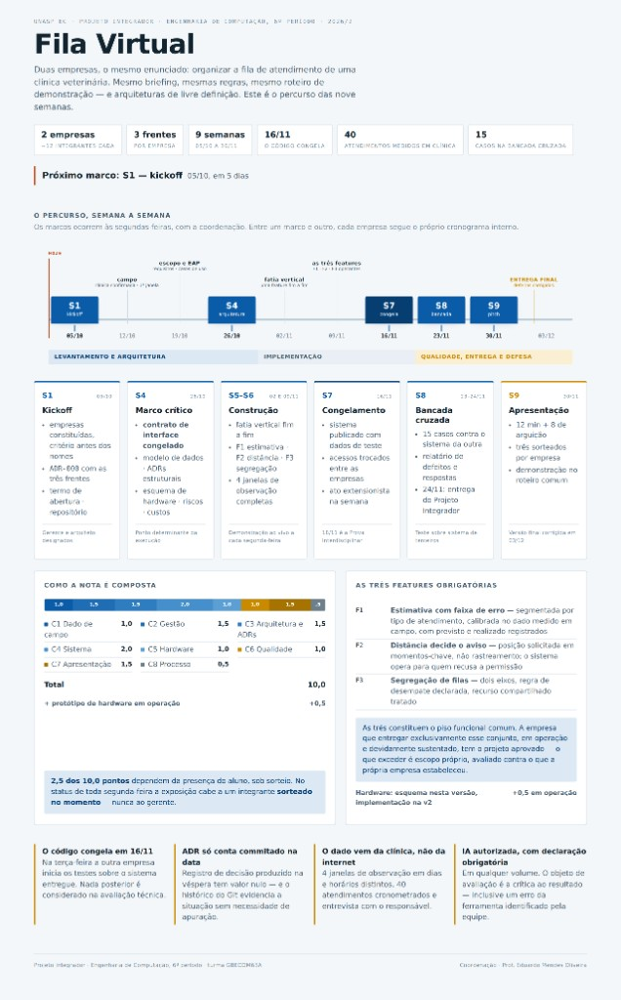

# Fila Virtual

_Sistema de fila e chamada para clínicas veterinárias — Projeto Integrador do 6º período de Engenharia de Computação (UNASP-EC, 2026/2)_

[Equipe](#equipe) • [Tema](#tema) • [Escopo](#escopo) • [Arquitetura](#arquitetura) • [Hardware](#hardware) • [Casos de Uso](#casos-de-uso) • [Cronograma](#cronograma) • [Avaliação](#avaliação) • [Como Rodar](#como-rodar) • [Documentação](#documentação)



---

## Equipe

A empresa se organiza em **três frentes** (exigência do caderno, seção 3) e **quatro squads** de execução. A decisão e o critério de divisão estão em [ADR-000](docs/adr/000-divisao-e-frentes.md).

| Papel / squad | Frente | Integrantes |
|---|---|---|
| Gerente de projeto | — | Gustavo Vieira |
| Arquiteto | — | Gustavo Vieira |
| Squad 1 — Fila (F3) | Domínio | Luís Gabriel |
| Squad 2 — Estimativa (F1) | Domínio | Gustavo Vieira, Gabriel Ciloé, Kevilly Vitória, Guilherme Pires |
| Squad 3 — Tutor (F2) | Canais | `<nomes> [TBD]` |
| Squad 4 — Campo e hardware | Borda | Philipe Gonçalves, Bruno Avelino |

Coordenação: Prof. Eduardo Mendes Oliveira. O professor atua como cliente único.

---

## Tema

Em uma clínica veterinária com demanda concentrada, o tutor espera na recepção com o animal no colo ou na caixa de transporte. Cães e gatos dividem o mesmo ambiente, animais reativos se agitam e ninguém sabe quanto falta. Boa parte dessa espera poderia acontecer fora da clínica, se o tutor soubesse a hora de voltar.

O Fila Virtual **gerencia a fila de atendimento**, **segrega os casos que não podem esperar no mesmo ambiente**, **estima o tempo restante declarando a incerteza** e **aciona o tutor no momento certo em função da distância dele**.

Restrições permanentes:

- O sistema **não toma decisão clínica**. Triagem e classificação de gravidade são do médico-veterinário.
- O tratamento de dados segue a **LGPD**.
- O domínio é veterinário de propósito: dado clínico humano é dado sensível, e o veterinário traz espécie, porte, temperamento e biossegurança para a disciplina da fila.

---

## Escopo

O piso funcional são as **três features obrigatórias** (caderno, seção 5):

**F1 — Estimativa de tempo com faixa de erro.** Tempo restante segmentado por tipo de atendimento (consulta, vacina, retorno, exame, emergência), apresentado como faixa p50–p90, calibrado com a série coletada na clínica parceira. O sistema registra previsto e realizado e mede o próprio erro.

**F2 — Distância do tutor como critério de acionamento.** A posição é pedida só em momentos-chave (entrada na fila, acionamento, confirmação de deslocamento), nunca de forma contínua. Guarda-se a faixa de distância ou o tempo de deslocamento, com consentimento e retenção curta. Quem recusa a localização é acionado por tempo fixo — isso é requisito, não concessão.

**F3 — Segregação de filas.** Pelo menos dois eixos (espécie e risco, a confirmar com o veterinário), regra de desempate declarada e tratamento de recurso compartilhado: o mesmo veterinário atende cães e gatos, mas a sala de isolamento é única. Emergência tem precedência, e quem a classifica é o profissional.

### Fora do escopo (versão atual)

- Triagem, score de gravidade ou qualquer decisão clínica pelo sistema
- Rastreamento contínuo de localização no navegador
- Aplicativo mobile nativo
- Protótipo de hardware em operação como compromisso (é bônus de +0,5)

Detalhes: [backlog](docs/requirements/backlog.md) e [SRS](docs/requirements/srs.md).

---

## Arquitetura

```text
┌──────────────────┐                    ┌──────────────────────────┐                    ┌────────────────────┐
│ Borda            │   HTTP ou MQTT     │ Domínio (API)            │   HTTP + push      │ Canais             │
│ totem / painel   │ ─────────────────► │ fila segregada (F3)      │ ◄────────────────► │ tela do tutor (F2) │
│ (esquema na v1)  │                    │ estimativa p50/p90 (F1)  │                    │ recepção           │
└──────────────────┘                    │ decisão de acionamento   │                    │ veterinário        │
                                        └────────────┬─────────────┘                    └────────────────────┘
  Série de campo (anexo D) ─────────────────────────►│
                                               banco de dados
```

Três contratos de interface, congelados em 26/10: Domínio para Canais, Canais para Domínio e Borda para Domínio. Stack: Node.js 24 + Fastify + Zod (API), React + Vite (telas), PostgreSQL no Neon ([ADR-004](docs/adr/004-escolha-da-stack.md)). Documento completo: [RFC-001](docs/rfc/rfc-001-arquitetura-mvp.md).

---

## Hardware

Nesta versão, o entregável é o **esquema de aplicação com hardware**: diagrama de blocos, componentes do inventário do laboratório ou orçados, protocolo com o servidor, alimentação calculada e ADR. A implementação é prevista para a v2; protótipo em operação até 30/11 vale +0,5 (teto 10,0).

| Alternativa | Função | Acoplamento |
|---|---|---|
| Totem de check-in com leitor RFID / microchip | Integra a chegada física à fila virtual | Evento de check-in na API de fila |
| Painel de chamada na recepção (microcontrolador + display) | Contraparte física da fila | Consome o estado da fila e exibe o código chamado |
| Sensor de presença ou contagem na recepção | Mede a ocupação real | Alimenta a F1 como variável auxiliar |

A escolha fica com o Squad 4 e entra em ADR no marco de 26/10.

---

## Casos de Uso

Alinhados ao roteiro de demonstração comum (anexo H). Especificação completa em [casos-de-uso.md](docs/requirements/casos-de-uso.md).

| ID | Caso de uso | Feature |
|---|---|---|
| UC-01 | Registrar chegada e informar estimativa com faixa | F1 |
| UC-02 | Inserir caso que exige segregação | F3 |
| UC-03 | Classificar emergência (ato do veterinário) | F3 |
| UC-04 | Acionar tutor por distância, inclusive com permissão negada | F2 |
| UC-05 | Encerrar atendimento e comparar previsto com realizado | F1 |
| UC-06 | Check-in pelo totem ou chamada no painel | Hardware |

---

## Cronograma

Marcos às segundas-feiras com a coordenação. Atraso em marco se resolve com redução de escopo, não com prorrogação.

| Semana | Data | Marco | Entrega principal |
|---|---|---|---|
| S1 | 05/10 | Kickoff | Empresas, critério de divisão, ADR-000, repositório, termo de abertura |
| S2 | 12/10 | Campo | Clínica parceira confirmada, cronograma, stakeholders, 1ª janela de observação |
| S3 | 19/10 | Escopo | Escopo e EAP, requisitos e casos de uso, 2 janelas, entrevista registrada |
| S4 | 26/10 | **Arquitetura (marco crítico)** | Contratos de interface congelados, modelo de dados, esquema de hardware, ADRs, riscos, custos |
| S5 | 02/11 | Fatia vertical | Uma feature fim a fim, 4 janelas concluídas, dado de campo versionado |
| S6 | 09/11 | As três features | F1, F2 e F3 em operação, plano de testes, riscos revisados |
| S7 | 16/11 | **Congelamento** | Código congelado, sistema publicado, manual, início da bancada cruzada |
| S8 | 23/11 | Bancada cruzada | Relatório entregue e respostas aos defeitos; 24/11 pacote do PI |
| S9 | 30/11 | Apresentação final | Demonstração no roteiro comum, confronto dos ADRs, relatório de extensão |
| — | 03/12 | Entrega final | Versão com defeitos corrigidos, documentação, lições aprendidas |

Datas que também pesam no cronograma: Prova Interdisciplinar em 18/11 e P2 de Gerenciamento de Banco de Dados em 01/12.

---

## Avaliação

| Critério | Pontos |
|---|---|
| C1 Dado de campo — cobertura, método e rastreabilidade | 1,0 |
| C2 Gestão — escopo, cronograma, riscos, custos, atas | 1,5 |
| C3 Arquitetura e ADRs | 1,5 |
| C4 Sistema — três features em operação, integração, publicação | 2,0 |
| C5 Hardware — esquema, componentes, alimentação, integração | 1,0 |
| C6 Qualidade — testes, bancada cruzada, respostas | 1,0 |
| C7 Apresentação e arguição (integrantes sorteados) | 1,5 |
| C8 Processo — repositório, ADRs datados, Registro de IA | 0,5 |
| **Total** | **10,0** |
| Bônus: protótipo de hardware em operação (teto 10,0) | +0,5 |

Regras que valem para todos:

- **O código congela em 16/11.** Na terça seguinte a outra empresa começa os testes.
- **ADR só conta commitado na data da decisão.**
- **O dado vem da clínica, não da internet.** 4 janelas de observação em dias e horários distintos, 40 atendimentos cronometrados, entrevista com o responsável.
- **IA é autorizada com declaração obrigatória** no [Registro de IA](docs/registro-ia.md).
- **Código que a empresa não sabe explicar não é código da empresa.** Qualquer integrante pode ser sorteado para expor qualquer parte.

---

## Como Rodar

> Os comandos abaixo valem a partir da fatia vertical (02/11), quando o código entra no repositório. Stack e versões: [ADR-004](docs/adr/004-escolha-da-stack.md).

Pré-requisitos: Node.js 24.22.0 (LTS) e um banco PostgreSQL 17 (local ou Neon).

```bash
git clone <url-do-repositorio>
cd Projeto-Integrador-Semestre-6
npm install                       # instala os workspaces apps/api, apps/web e packages/contratos
cp apps/api/.env.example apps/api/.env   # preencher DATABASE_URL
npm run db:migrate -w apps/api    # aplica as migrações do drizzle-kit
npm run dev                       # API em http://localhost:3000 (OpenAPI em /docs) e telas em http://localhost:5173
```

Testes:

```bash
npm test                          # unit + contract (Vitest), bloqueiam o merge
npm run test:integration          # API com banco real
npm run test:e2e                  # roteiro de demonstração (Playwright)
```

---

## Documentação

| Documento | Conteúdo |
|---|---|
| [docs/README.md](docs/README.md) | Portfólio: equipe, tema, escopo, links |
| [docs/process.md](docs/process.md) | Ciclo semanal, quadro kanban, DoR, DoD, PR e review |
| [Quadro kanban (GitHub Project)](https://github.com/users/arauj-gugs/projects/7) | Tarefas de cada squad por marco, de S3 até a entrega final |
| [docs/metrics.md](docs/metrics.md) | Métricas de saúde do processo |
| [docs/requirements/stakeholders.md](docs/requirements/stakeholders.md) | Mapa de stakeholders |
| [docs/requirements/backlog.md](docs/requirements/backlog.md) | Backlog v0.1 (MoSCoW, NFR, restrições) |
| [docs/requirements/srs.md](docs/requirements/srs.md) | Especificação de requisitos |
| [docs/requirements/casos-de-uso.md](docs/requirements/casos-de-uso.md) | Casos de uso com exceções |
| [docs/rfc/rfc-001-arquitetura-mvp.md](docs/rfc/rfc-001-arquitetura-mvp.md) | RFC de arquitetura |
| [docs/adr/](docs/adr/) | Registros de decisão de arquitetura, datados |
| [docs/scm-plan.md](docs/scm-plan.md) | Plano de SCM |
| [docs/test-strategy.md](docs/test-strategy.md) | Estratégia de testes v0.1 |
| [docs/registro-ia.md](docs/registro-ia.md) | Registro de uso de IA |
| [docs/atas/](docs/atas/) | Atas das reuniões de segunda-feira |
| [Caderno do aluno (PDF)](Projeto_Integrador_Fila_Virtual_Caderno_do_Aluno_1.pdf) | Enunciado oficial do projeto |
