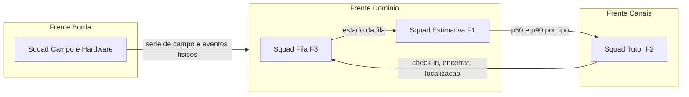

# ADR-000 — Divisao da empresa em frentes e squads

Data: 2026-10-20
Status: proposto
Decidem: Gustavo Vieira (gerente e arquiteto), assembleia da empresa

## Contexto

O caderno do aluno (secao 3) exige que cada empresa se organize em tres
frentes de trabalho, com fronteiras declaradas por escrito, alem de um gerente
de projeto e um arquiteto. A ata de segunda-feira (anexo G) e o marco de 26/10
(contrato de interface congelado) medem exatamente essas tres frentes.

A empresa tem cerca de 12 integrantes. Tres frentes de quatro pessoas cada
deixam F1 e F3 na mesma equipe, e essas duas features concentram a maior parte
da engenharia: alocacao de recurso compartilhado e estimativa calibrada com
faixa. Pela Lei de Conway, a forma das equipes se reproduz na forma do sistema,
entao cada fronteira de equipe vira uma fronteira de integracao.

O plano de riscos ja marca como alto o risco R3: as frentes nao integrarem a
tempo.

## Criterio de divisao

Declarado em assembleia antes da composicao das listas:

- equilibrio de competencias entre squads;
- ao menos um integrante com experiencia em back-end na frente Dominio;
- ao menos um integrante com experiencia em front-end na frente Canais;
- ao menos um integrante com experiencia em hardware na frente Borda;
- ao menos um integrante com experiencia em banco de dados na frente Dominio;
- nenhuma composicao por afinidade pessoal.

## Opcoes consideradas

1. Tres frentes, uma equipe por frente
   - \+ cumpre o caderno de forma literal; tres contratos de interface
   - \- F1 e F3 ficam na mesma equipe e disputam as mesmas pessoas
2. Quatro frentes independentes, uma por squad
   - \+ cada squad tem fronteira propria e dono claro
   - \- quatro contratos de interface; diverge da ata e do marco de 26/10;
     aumenta o risco R3
3. Quatro squads agrupados em tres frentes
   - \+ dono claro para F1 e F3 sem criar uma quarta fronteira externa
   - \+ mantem tres contratos de interface, como pede o caderno
   - \- exige contrato interno entre os dois squads da frente Dominio

## Decisao

Opcao 3. Gerente e arquiteto podem acumular papel em um squad. Na
composicao atual, o mesmo integrante acumula gerencia, arquitetura e o
Squad 2, porque e quem concentra a experiencia em banco de dados e
modelagem que a frente Dominio exige.

| Frente | Squad | Responsabilidade principal |
|---|---|---|
| Dominio | Squad 1 — Fila (F3) | segregacao, alocacao e emergencia |
| Dominio | Squad 2 — Estimativa (F1) | tempo por tipo com faixa p50/p90 e erro |
| Canais | Squad 3 — Tutor (F2) | acionamento por distancia e telas |
| Borda | Squad 4 — Campo e hardware | coleta em clinica e esquema de hardware |

### Squad 1 — Fila (F3), frente Dominio

- No minimo dois eixos de segregacao levantados com o veterinario da clinica
  parceira (especie, motivo, risco ou recurso).
- Regra de desempate declarada.
- Recurso compartilhado tratado como alocacao: o mesmo veterinario atende caes
  e gatos, e a sala de isolamento e unica.
- Emergencia tem precedencia somente quando o profissional a classifica. O
  sistema nao faz triagem nem classifica gravidade.
- Dono da API de ingresso, posicao, classificacao de emergencia e
  encerramento.

### Squad 2 — Estimativa (F1), frente Dominio

- Estimativa segmentada por tipo de atendimento.
- Faixa por percentis (p50 e p90), com a escolha justificada em ADR proprio.
- Calibracao exclusivamente com a serie medida em campo.
- Registro do previsto e do realizado, com erro medio do periodo exposto.
- Consome a serie versionada pelo Squad 4.

### Squad 3 — Tutor (F2), frente Canais

- Posicao solicitada so em momentos-chave: entrada na fila, acionamento e
  confirmacao de deslocamento.
- Persiste faixa de distancia ou tempo de deslocamento. Coordenada precisa
  so com ADR que a justifique.
- Consentimento explicito, finalidade declarada e retencao curta.
- Acionamento por tempo fixo para quem recusa a localizacao.
- Dois canais de aviso com confirmacao de leitura (risco R1).
- Telas de tutor e recepcao que cobrem o roteiro de demonstracao (anexo H).

### Squad 4 — Campo e hardware, frente Borda

- Protocolo de coleta, fichas de observacao (anexo D), entrevista (anexo E) e
  serie digitada e versionada, separando observacao direta de registro
  retrospectivo.
- Minimo de 40 atendimentos, 4 tipos e 4 janelas de 1 hora em dias e horarios
  distintos, sem identificar pessoas nem nomes de animais.
- Esquema de hardware: diagrama de blocos, componentes do laboratorio ou
  orcados, protocolo HTTP ou MQTT justificado, alimentacao calculada e ADR.
- Publica eventos fisicos no contrato da frente Dominio; nao expoe API de
  negocio propria.
- Apoia a publicacao do ambiente de teste e o plano de testes.

A escala das janelas de observacao e da empresa inteira; o Squad 4 conduz o
protocolo, digita e entrega a serie. A bancada cruzada, a partir de 16/11,
tambem e da empresa inteira.

### Contratos de interface a congelar em 26/10

- Dominio para Canais: ingresso do animal, posicao na fila segregada,
  classificacao de emergencia pelo profissional, encerramento com duracao real
  e estimativa p50/p90 por tipo.
- Canais para Dominio: amostra de distancia, ou recusa, apenas nos
  momentos-chave.
- Borda para Dominio: evento fisico de check-in ou de painel, e arquivo
  versionado da serie de campo no formato do anexo D.

### Composicao

| Papel / squad | Integrantes |
|---|---|
| Gerente de projeto | Gustavo Vieira |
| Arquiteto | Gustavo Vieira |
| Squad 1 — Fila | Luís Gabriel |
| Squad 2 — Estimativa | Gustavo Vieira, Gabriel Ciloé, Kevilly Vitória, Guilherme Pires |
| Squad 3 — Tutor | `<nomes> [TBD]` |
| Squad 4 — Campo e hardware | Bruno Avelino |

Pendencia mais urgente: o Squad 3 esta sem integrantes. F2 e feature
obrigatoria e a frente Canais concentra as telas do roteiro de demonstracao,
entao a composicao precisa ser fechada antes do marco de 26/10.

## Consequencias aceitas

- O acumulo de gerencia, arquitetura e Squad 2 na mesma pessoa cria ponto
  unico de falha nas decisoes de contrato. Mitigacao: mudanca em contrato
  congelado exige tambem aprovacao de integrante das frentes Canais ou Borda
  (docs/scm-plan.md), e a exposicao sorteada de segunda-feira nunca cabe ao
  gerente, o que forca a informacao a circular.
- A frente Dominio carrega dois squads e um contrato interno entre fila e
  estimativa, mantido pelo arquiteto.
- A ata registra o estado das tres frentes (0 a 4); o estado de cada squad
  aparece nos bloqueios e compromissos.
- O Squad 4 depende da autorizacao da clinica para iniciar a coleta; ate la,
  concentra-se no esquema de hardware.
- Cada integrante precisa sustentar o projeto inteiro na arguicao sorteada,
  entao as revisoes de codigo cruzam squads.
- Fora de escopo: decisao clinica pelo sistema, rastreamento continuo no
  navegador e prototipo de hardware em operacao como compromisso (e bonus).
