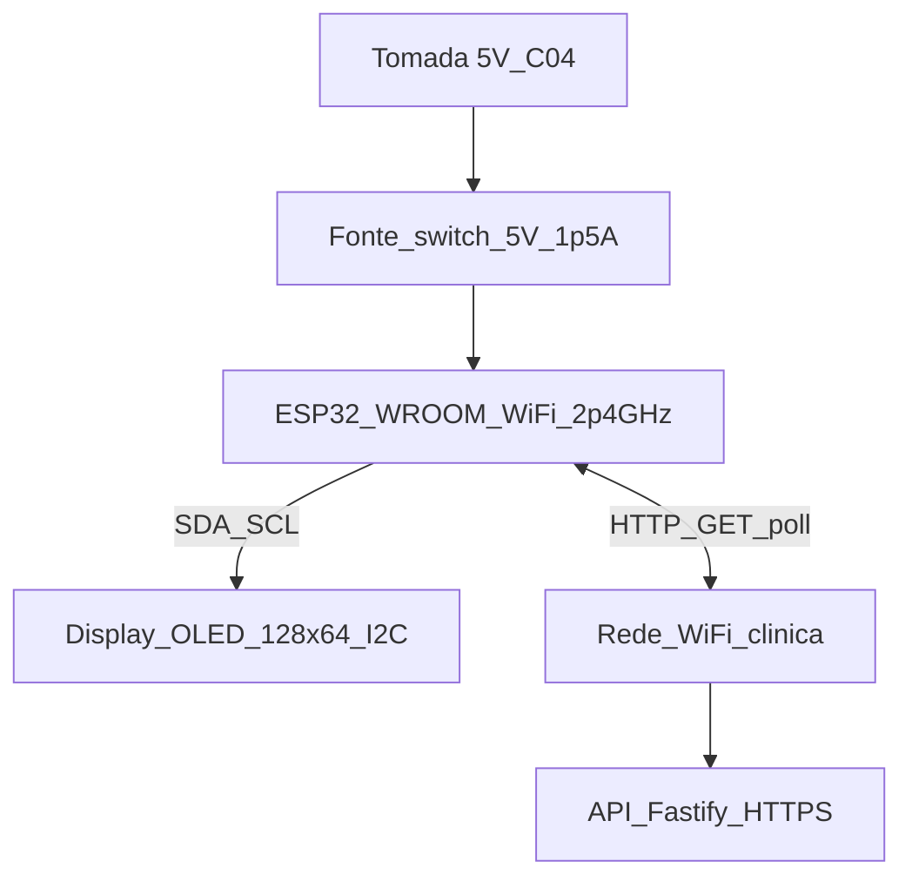

# Esquema — painel de chamada (RF-18)

| Campo | Valor |
|---|---|
| Issue | #63 (C5) |
| ADR | [005 — hardware](../adr/005-escolha-do-hardware.md) |
| UC | [UC-06](../requirements/casos-de-uso.md) passo 5, E4, A1 |

Exibe o código do atendimento chamado (ex.: `A017`) em ≤ 5 s após o veterinário acionar **chamar próximo**. Não cria ingresso; se offline, mostra estado em ≤ 10 s (RNF-13).

---

## Diagrama de blocos

**Fluxo de dados (v1.1):** o painel consulta periodicamente a API (endpoint e schema na issue #64) com chave de dispositivo; recebe código chamado ou indicação `offline` se a rede falhar.

---

## Lista de componentes (BOM)

| Qtd | Item | Função | Origem | Preço (BRL) | Prazo | Observação |
|---|---|---|---|---|---|---|
| 1 | ESP32-WROOM-32 devkit (USB/UART) | MCU + Wi-Fi | `laboratorio_provavel` | — | — | Conferir inventário lab (C-02) |
| 1 | OLED 0,96" 128×64 I2C (SSD1306) | Exibir código / offline | `laboratorio_provavel` | — | — | Endereço I2C 0x3C típico |
| 1 | Cabo USB ou fonte 5 V dedicada | Alimentação fixa recepção | `orcamento_pendente` | — | — | Preferir fonte tomada após devkit (C-04) |
| 1 | Fonte chaveada 5 V / 1,5 A | Alimentação contínua | `orcamento_pendente` | — | — | Ver dimensionamento abaixo |
| n | Jumpers, suporte, gabinete aberto | Montagem bancada | `laboratorio_provavel` | — | — | Gabinete definitivo fora do escopo v1 |

Não há preço inventado: equipe atualiza após cotação (C-02).

---

## Cálculo de consumo e fonte (RNF-11, C-04)

Valores de **projeto** (datasheet; medição no protótipo #68).

| Modo | ESP32 (mA @ 5 V) | Display (mA) | Total (mA) |
|---|---|---|---|
| Repouso (Wi-Fi ligado, baixo duty) | 80 | 20 | 100 |
| Atualização display + poll API | 120 | 40 | 160 |
| **Pico** (associação / TX Wi-Fi) | 280 | 60 | **340** |

Dimensionamento:

- `I_min = 340 × 1,30 = 442 mA`
- Fonte escolhida (projeto): **5 V / 1,5 A** (margem ~4,4× sobre pico; adeq. RNF-11)
- Alimentação: tomada 5 V na recepção (C-04), não bateria

---

## Referências

- [esquema-registro.md](esquema-registro.md) · [esquema-totem.md](esquema-totem.md) · UC-06 E4 · RNF-12 (painel não envia eventos grandes; estado consumido da API)
