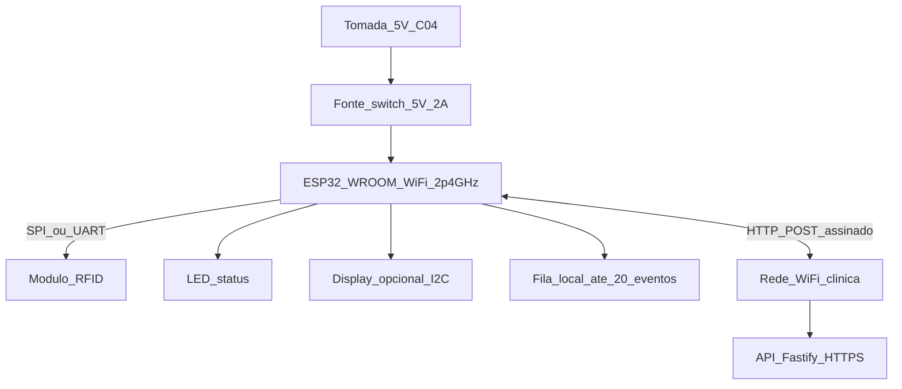

# Esquema — totem de check-in (RF-19)

| Campo | Valor |
|---|---|
| Issue | #63 (C5) |
| ADR | [005 — hardware](../adr/005-escolha-do-hardware.md) |
| UC | [UC-06](../requirements/casos-de-uso.md) passos 1–2, E1, E2, A1 |

Lê microchip/tag RFID, envia evento de check-in **assinado** (≤ 256 B, RNF-12) à API; a recepção confirma o ingresso (UC-01). LED e display dão feedback de leitura inválida (E1). Com Wi-Fi indisponível, bufferiza até 20 eventos e reenvia (E2).

---

## Diagrama de blocos

---

## Lista de componentes (BOM)

| Qtd | Item | Função | Origem | Preço (BRL) | Prazo | Observação |
|---|---|---|---|---|---|---|
| 1 | ESP32-WROOM-32 devkit | MCU + Wi-Fi | `laboratorio_provavel` | — | — | Conferir inventário lab |
| 1 | Módulo leitor RFID 13,56 MHz (MFRC522 ou similar) | Leitura tag HF | `orcamento_pendente` | — | — | Se o lab só tiver 125 kHz, ajustar firmware e documentar equivalente |
| 1 | LED verde + LED vermelho + resistor | Feedback E1 | `laboratorio_provavel` | — | — | — |
| 1 | OLED 0,96" I2C (opcional) | Mensagem ao tutor | `laboratorio_provavel` | — | — | Pode compartilhar referência com painel |
| 1 | Fonte chaveada 5 V / 2 A | Alimentação com pico RFID + Wi-Fi | `orcamento_pendente` | — | — | Ver dimensionamento |
| n | Antena/passivo conforme módulo RFID | Acoplamento tag | `orcamento_pendente` | — | — | Incluso no kit do módulo, se houver |

---

## Cálculo de consumo e fonte (RNF-11, C-04)

| Modo | ESP32 (mA) | RFID (mA) | Display (mA) | Total (mA) |
|---|---|---|---|---|
| Repouso | 80 | 10 | 20 | 110 |
| Leitura ativa + POST | 200 | 120 | 40 | 360 |
| **Pico** (TX Wi-Fi + RFID) | 280 | 120 | 60 | **460** |

Dimensionamento:

- `I_min = 460 × 1,30 = 598 mA`
- Fonte escolhida (projeto): **5 V / 2 A** (margem sobre pico; RNF-11)
- Alimentação: tomada 5 V (C-04)

**UC-06 E2:** fila de até 20 eventos na RAM/flash do ESP32; eventos com mais de 15 min descartados no firmware (especificação de comportamento; implementação v2/#68).

---

## Referências

- [esquema-registro.md](esquema-registro.md) · [esquema-painel.md](esquema-painel.md) · Issue #64 (schema Zod do POST check-in)