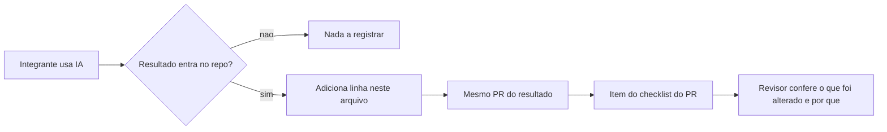

# Registro de IA

Uso de ferramentas de IA é autorizado em qualquer volume, com declaração obrigatória (caderno, seção 8). O que se avalia é a qualidade da crítica ao resultado, não o volume. Uso declarado nunca é penalizado; uso não declarado, havendo evidência, zera o critério C8.

## Como usar

- **Quando registrar:** sempre que um resultado de IA entra no repositório (código, documento, ADR, teste, dado tratado). Pergunta de dúvida que não vira artefato não precisa de linha.
- **Quem:** o autor do PR, na mesma branch e no mesmo PR do resultado. O [template de PR](../.github/pull_request_template.md) cobra esse item.
- **O que escrever:** o que foi pedido (resumo do prompt), o que voltou e, principalmente, o que a equipe alterou e por quê. "Usado sem alteração" é aceitável, desde que diga como foi verificado.
- **Erro identificado:** todo erro de IA encontrado durante o semestre vira candidato na lista de candidatos abaixo; antes de 30/11 a equipe escolhe um para a seção de encerramento.
- **Rastro no commit (opcional):** rodapé `Assisted-by: <ferramenta>` no commit, para cruzar com este registro.

## Registro

| Data | Integrante | Ferramenta | O que foi solicitado | O que retornou | O que a equipe alterou e por quê |
|---|---|---|---|---|---|
| 2026-10-11 | `<nome>` | Cursor (agente) | Dividir a empresa em cerca de 4 squads a partir do caderno | Proposta de 4 squads em 3 frentes e rascunho do [ADR-000](adr/000-divisao-e-frentes.md) | `<a preencher: o que a assembleia manteve ou mudou>` |
| 2026-10-14 | Gustavo Vieira | Cursor (agente) | Comparar stacks e fechar o ADR-004 com versões pinadas | Comparação Python/FastAPI versus Node/Fastify, recomendando FastAPI; versões consultadas no npm e em nodejs.org | A equipe escolheu Node/Fastify (contrário à recomendação) pela continuidade com o projeto anterior em JavaScript; o agente propôs Node 22 no plano, corrigido para 24.22.0 porque a 24 é a LTS ativa na data |
| 2026-10-14 | `<nome>` | Cursor (agente) | Adaptar a documentação do projeto anterior (Horta) às etapas A1.0 a A1.6 para o Fila Virtual | README, docs de processo e métricas, stakeholders, backlog, SRS, casos de uso, RFC, ADRs 001 a 004, plano de SCM, templates do GitHub e estratégia de testes | `<a preencher: valores revisados, eixos confirmados com o veterinário, etc.>` |
| 2026-10-20 | Gustavo Vieira | Cursor (agente) | Montar o kanban de tarefas por squad, de S3 até a entrega final, no GitHub | 72 issues com critério de aceitação e referências a RF, UC e ADR; labels por squad e MoSCoW; 8 milestones (um por marco); GitHub Project com campos Status, Squad e Prioridade | `<a preencher: tarefas removidas, movidas de marco ou reatribuídas na revisão do board pela empresa>` |
| 2026-10-20 | Gustavo Vieira | Cursor (agente) | Aplicar a proteção da `main` descrita no plano de SCM (issue #5), criar `.gitignore` e `CODEOWNERS` | Proteção aplicada via API, `.gitignore`, `CODEOWNERS` para contratos e modelo de dados, evidência no plano de SCM | O agente apontou que `CODEOWNERS` em repositório de usuário exige só um dos donos, não "arquiteto e outra frente"; o texto da seção 1.2 foi ajustado para dizer o que o GitHub garante e o que fica como regra de processo. O agente pôs só o Bruno como dono de fora do Domínio, a partir do ADR-000 desatualizado; o gerente trocou por donos por caminho com Jenifer Gomes (Canais) e Philipe Gonçalves (Borda) |
| 2026-11-15 | Gustavo Vieira | Cursor (agente) | Organizar notas desordenadas da entrevista na clínica e atualizar RF/ADR | `docs/campo/entrevista-2026-10.md`, `decisoes-da-clinica.md`, RF-01/02/03 e contexto do ADR-003 | A equipe revisa se "urgência" clínica precisa de estado próprio além de emergência (RF-05); salas de isolamento e faixas F2 ficam para as janelas |
| 2026-11-15 | Gustavo Vieira | Cursor (agente) | Implementar as issues #32–#41 do Squad 2 (motor p50/p90, importação, previsto/realizado, histórico e barras) | Monorepo `apps/api`, `apps/web`, `packages/contratos`; reamostragem mulberry32; planilha-oráculo; API e tela de histórico | Mantidos #33 e #40 abertos (sem série real da clínica, C-09). `@vitejs/plugin-react` em 6.0.0 para casar com Vite 8.3.4 do ADR-004. Persistência da F1 em memória nesta fatia; schema Drizzle só como contrato de dados. Fixture CSV sintético rotulado, distinto da série da #65 |
| 2026-11-16 | Gustavo Vieira | Cursor (agente) | Corrigir leitura das estimativas na tela (previsto 0 e erro absurdo) | Separou previsto do ingresso de espera_atual; histórico compara espera vs espera; fixture da entrevista | Confirmado que hífen da clínica nunca era parseado como menos. Amostras da entrevista com `origem=entrevista`, sem substituir a série #65 |
| 2026-11-16 | Gustavo Vieira | Cursor (agente) | Fechar lacunas da F1: OpenAPI em /docs, README e PR | Swagger + swagger-ui; README com demo:local e store em memória | GPS/F2 e issues #33/#40 ficaram de fora (série real / Squad 3) |
| 2026-11-16 | Philipe Gonçalves | Cursor (agente) | Conferir se a issue #23 fecha com a entrevista já em `main` (commit `928a6c9`, PR #75), sem reescrever o levantamento | Confirmação dos dois critérios: eixos espécie e risco/comportamento mais FIFO de pequenos, com fonte em `docs/campo/entrevista-2026-10.md` e `decisoes-da-clinica.md`; RF-02 e RF-03 já apontam essa entrevista | Nada do texto de campo foi reescrito. Salas de isolamento, dois reativos ou cio ao mesmo tempo e "urgência" como estado ficam para as janelas. O aceite do ADR-003 continua na issue #24 |
| 2026-11-16 | Gustavo Vieira | Cursor (agente) | Banco local no Docker: Postgres 17, schema Drizzle do prontuário simulado + fila, API saindo da memória, rotas de cadastro/agenda, sem commit | `docker-compose.yml`, migração `apps/api/drizzle/`, store/rotas no Postgres, seed, OpenAPI atualizado, README e decisão de campo | Evento de fila e acionamento estavam sendo gravados antes do atendimento (FK); ordem corrigida. OpenAPI congelado precisou incluir as rotas novas do prontuário |
| 2026-11-16 | Philipe Gonçalves | Cursor (agente) | Aceitar o ADR-003 (issue #24): status aceito, exemplo de sala ocupada e resumo na RFC-001 | Status aceito em 2026-11-16; exemplo concreto alinhado ao UC-02 E1; RFC seção 6 atualizada de Proposto para Aceito | Mantida a premissa de sala única (RF-04) enquanto as janelas não confirmam o número; o alocador em código continua na issue #28 |
| 2026-11-16 | Philipe Gonçalves | Cursor (agente) | Schemas Zod da issue #25 em `packages/contratos` (ingresso, posição, emergência, encerramento, 422 e 403), commit sem PR | Pacote `@fila-virtual/contratos`, testes Vitest e paths anotados na RFC-001 seção 5.2 | Porte ficou texto livre porque a entrevista não fechou a escala; a #25 não foi fechada — falta revisão do Squad 3 no PR |
| 2026-11-16 | Philipe Gonçalves | Cursor (agente) | Primeira rota `POST /atendimentos` e teste de contrato (issue #26), commit sem PR | `apps/api` com store em memória, `fastify.inject`, log em `docs/test-strategy/evidencias/contract-2026-11-16.log` | Estimativa fixa stub até o Squad 2; override `cookie@1.0.2` na raiz para `inject` em Node 20 local |
| 2026-11-16 | Philipe Gonçalves | Cursor (agente) | Motor de fila segregado (issue #27), commit sem PR | `motor.ts`, `derive-risco.ts`, testes unit RF-02/03/RF-12; `memoria.ts` usa `ingressar` | Alocador e emergência na fila ficam na #28; `REGRA_DESEMPATE = fifo_chegada` |
| 2026-11-16 | Philipe Gonçalves | Cursor (agente) | Corrigir body 422 do POST /atendimentos para lista completa (`erros422Schema`) | Rota envia array de `erros422DeZod`; teste de contrato com múltiplos campos ausentes | Antes só `erros[0]`; alinhado ao contrato #25 |
| 2026-11-16 | Philipe Gonçalves | Cursor (agente) | Alocador RF-04 com sala única (issue #28) | `recursos.ts`, `alocador.ts`, testes ADR/UC-02; sala pode ficar ocupada com veterinário livre (E1) | RF-05/emergência e rotas HTTP ficam na #29+; `liberarVeterinarioMantendoSalaIsolamento` usado nos testes para o exemplo do ADR-003 |
| 2026-11-16 | Philipe Gonçalves | Cursor (agente) | Encerramento com validação de duração (issue #30) | `registro.ts`, `POST /chamar-proximo` e `POST /atendimentos/:id/encerrar`, UC-05 E2, stub RF-07 | Recálculo de estimativa fica no Squad 2; histórico RF-10 fora do escopo |
| 2026-11-16 | Philipe Gonçalves | Cursor (agente) | Estado da fila por SSE (issue #31) | `GET /fila/stream`, hub `fila-eventos`, snapshot após ingresso/chamar/emergência/encerrar; teste 50× p95 | Stream sem auth na v0.1; consumo React e schema Zod do snapshot ficam no Squad 3 |
| 2026-11-16 | Philipe Gonçalves | Cursor (agente) | Corrigir estado `aguardando_sala` no snapshot SSE (pós-#31) | `estadoPublico` deriva bloqueio por sala na cabeça de isolamento; testes unit UC-02 E1 | `POST /atendimentos` ainda devolve `na_fila` no corpo; alinhar em issue futura se o contrato de resposta exigir |
| 2026-11-16 | Philipe Gonçalves | Cursor (agente) | Issue #55 — registrar status R2 (autorização por visita, reserva pendente) sem inventar termo ou nome de clínica | `docs/campo/autorizacao-clinica.md`, links em entrevista, decisões, RFC R2 e docs/README | Mantido status honesto 1-A/2-B; modelo de termo para uso fora do Git; #55 permanece aberta até formalizar e nomear reserva |
| 2026-11-16 | Philipe Gonçalves | Cursor (agente) | Issue #56 — protocolo de coleta, ficha anexo D, pasta `campo/` e CSV exemplo com coluna `fonte` | `protocolo-coleta.md`, `ficha-observacao.md`, `campo/README.md`, `exemplo-serie-anexo-d.csv` | Revisão humana das janelas reais continua em #58–#61; Squad 2 alinha import RF-11 às colunas extras |
| 2026-11-16 | Philipe Gonçalves | Cursor (agente) | Issue #58 — janela 1: registro pendente sem CSV inventado (estado B; C-09) | `janela-1-registro.md`, índice em `campo/README` e links | Equipe sem série cronometrada no repo; entrevista out/2026 não conta como janela; #58 aberta até visita de 1 h |
| 2026-11-16 | Philipe Gonçalves | Cursor (agente) | Issue #59 — janela 2: registro pendente, regra dia/hora ≠ janela 1 (estado B) | `janela-2-registro.md`, cross-links e índice `campo/` | Sem CSV inventado; #59 aberta até coleta real distinta da janela 1 |
| 2026-11-16 | Philipe Gonçalves | Cursor (agente) | Issue #60 — janela 3: registro pendente, distinção das janelas 1 e 2 (estado B) | `janela-3-registro.md`, cross-links | Sem CSV inventado; #60 aberta até coleta real |
| 2026-11-16 | Philipe Gonçalves | Cursor (agente) | Issue #61 — janela 4: registro pendente, tabela meta 40 atendimentos / 4 motivos (estado B) | `janela-4-registro.md`, `campo/README` | #65 série consolidada fica após coleta real; #61 aberta |
| 2026-11-16 | Philipe Gonçalves | Cursor (agente) | Issue #62 — ADR-005: totem + painel, HTTP(S), ESP32, cálculo 5 V (C-04, RNF-11) | `docs/adr/005-escolha-do-hardware.md`, RFC-001 §9, link no ADR-004 | Esquema de blocos e BOM na #63; contrato e fixtures na #64; MQTT fora do escopo v1 |
| 2026-11-16 | Philipe Gonçalves | Cursor (agente) | `definirEmergencia` lança `AtendimentoNaoEncontrado` (rota emergência 404) | `motor.ts`, testes unit e contrato UC-03 | `alocador.ts` mantém erro interno na falha de retirada da cabeça |
| 2026-11-16 | Philipe Gonçalves | Cursor (agente) | Issue #63 — esquema painel e totem (diagrama, BOM C-02, fonte 5 V) | `docs/hardware/esquema-*.md`, ADR-005 e RFC-001 §9 | Inventário lab a conferir na BOM; contrato #64 em `packages/contratos` |
| 2026-11-16 | Philipe Gonçalves | Cursor (agente) | `liberarSalaIsolamento` não zera `atendimentoAtual` (UC-02 E1) | `recursos.ts`, assert no teste ADR-003 | Sala via `ocupanteSalaIsolamento`; vet no `atendimentoAtual` |
| 2026-11-16 | Philipe Gonçalves | Cursor (agente) | Issue #64 — contrato Borda Zod + fixtures 256 B (UC-06) | `borda.ts`, `fixtures/borda/`, `test/borda.test.ts` | Rotas API totem ficam Squad 1; revisão CODEOWNERS contratos |
| 2026-11-16 | Philipe Gonçalves | Cursor (agente) | Issue #65 — série consolidada estado B: registro, scripts consolidar/validar, RF-11 pendente na série real | `serie-registro.md`, `campo/scripts/`, `campo/README`, `protocolo-coleta` | Sem `serie-consolidada-*.csv` inventado (C-09); `Refs #65`; smoke em `exemplo-serie-anexo-d.csv` |
| 2026-11-16 | Philipe Gonçalves | Cursor (agente) | `liberarAposEncerramento` sempre sincroniza sala com `ocupanteSalaIsolamento` (UC-02 E1) | `recursos.ts`, teste alocador | Evita sala `livre` stale com ocupante persistente após encerrar caso comum |
| 2026-11-16 | Philipe Gonçalves | Cursor (agente) | Issue #66 — workflow ci (typecheck, test, integration PG17), scripts raiz, smoke integration | `.github/workflows/ci.yml`, `docs/ci-registro.md`, scm-plan | Proteção `main` com novos checks: gerente após primeiro CI verde; `Refs #66` até aplicar |
| 2026-11-16 | Philipe Gonçalves | Cursor (agente) | Issue #67 — manual bancada, seed, deploy Render, estado B sem URL pública | `docs/manual-bancada.md`, `scripts/seed-bancada.mjs`, `render.yaml`, `apps/api/src/server.ts` | `Refs #67`; Closes após deploy + monitor RNF-10 |
| 2026-11-16 | Gustavo Vieira | Cursor (agente) | Integrar fila (`feat/issue-31`) com estimativa no branch `feat/tutor` e ligar o stub ao motor p50/p90 | App único com rotas F3 + F1; tipos RF-01 no motor; `estimarNoIngresso` no lugar do stub fixo | Contrato Domínio→Canais da fila prevalece; aliases retorno/exame mapeados para consulta/ultrassom na importação |
| 2026-11-16 | Gustavo Vieira | Cursor (agente) | Fechar issues #42–#54 do Squad 3 (wireframes, ADR-001, localização, telas, acionamento, SSE, 24 h) | Schemas `localizacao`, motor F2, telas recepção/vet/tutor, SSE+polling, segundo canal na recepção | Segundo canal = alerta na recepção (sem SMS); link do tutor em hash `#/tutor/` para não colidir com proxy da API |
| 2026-11-16 | Gustavo Vieira | Cursor (agente) | Fechar lacunas de código #66, #64 e #9 (CI, contrato Borda, OpenAPI congelado) | Workflow `ci.yml` (typecheck + test); schemas e fixtures da Borda com limite 256 bytes; `docs/contratos/openapi.json` gerado e comparado no teste de contrato | OpenAPI congelado em 16/11 (schemas não existiam em 26/10). Postgres no CI e publicação (#10) ficaram de fora — API ainda em memória. Checks `test`/`typecheck` só entram na proteção da `main` depois do merge do workflow |
| 2026-11-16 | Gustavo Vieira | Cursor (agente) | Frontend de produto: casca da clínica e do celular, redesign das telas sem biblioteca nova e sem commit | Tokens CSS, shell lateral, recepção com filas lado a lado, vet em dois painéis, tutor/meu-animal no celular, cadastro em abas, histórico com MAE em destaque, `rotulos.ts` | Mantidas as chamadas de API e o hash router; sem "alterar tipo" (API não tem); QR externo permanece; perfil continua no header `api()` |
| 2026-11-16 | Gustavo Vieira | Cursor (agente) | Painel hospitalar da fila: nomes, tempos, emergência pela recepção, tirar da fila (desistência) | Snapshot enriquecido; `POST /cancelar`; auth emergência recepção+vet; recálculo espera como `emergencia`; home = painel; ingresso recolhido | Exceção explícita a RF-05 na decisão de campo; tutor ainda 403; sem chamar fora de ordem |
| 2026-11-16 | Gustavo Vieira | Cursor (agente) | Recepção kanban: + nas colunas, emergência direta, Em atendimento Cães/Outros | `recursos` multi-slot; `chamar-proximo` por lane + recepção; `GET/PATCH /fila/capacidades`; snapshot com lanes caes/outros; UI recepção/vet/TV | Capacidades só em memória; colunas de espera inalteradas; exceção RF-15 (recepção chama) |

## Erro da ferramenta identificado pela equipe

Seção obrigatória de encerramento: um erro cometido pela ferramenta neste projeto, como foi detectado e qual correção foi aplicada.

- **Erro:** `<a preencher>`
- **Como foi detectado:** `<a preencher>`
- **Correção aplicada:** `<a preencher>`

### Candidatos

> Candidato já observado: a primeira versão do ADR-002 descrevia a estimativa por "simulação simples", o que contradiz o critério de aceitação de RF-06 (resultado conferível à mão contra planilha). Foi corrigido para reamostragem com semente fixa. A equipe deve confirmar se este é o caso a relatar ou substituí-lo por outro encontrado na revisão.
