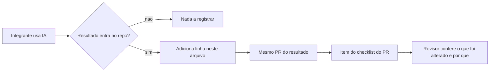

# Registro de IA

Uso de ferramentas de IA é autorizado em qualquer volume, com declaração obrigatória (caderno, seção 8). O que se avalia é a qualidade da crítica ao resultado, não o volume. Uso declarado nunca é penalizado; uso não declarado, havendo evidência, zera o critério C8.

## Como usar

- **Quando registrar:** sempre que um resultado de IA entra no repositório (código, documento, ADR, teste, dado tratado). Pergunta de dúvida que não vira artefato não precisa de linha.
- **Quem:** o autor do PR, na mesma branch e no mesmo PR do resultado. O [template de PR](../.github/pull_request_template.md) cobra esse item.
- **O que escrever:** o que foi pedido (resumo do prompt), o que voltou e, principalmente, o que a equipe alterou e por quê. "Usado sem alteração" é aceitável, desde que diga como foi verificado.
- **Erro identificado:** todo erro de IA encontrado durante o semestre vira candidato na lista de candidatos abaixo; antes de 30/11 a equipe escolhe um para a seção de encerramento.
- **Rastro no commit (opcional):** rodapé `Assisted-by: <ferramenta>` no commit, para cruzar com este registro.

## Registro

| Data | Integrante | Ferramenta | O que foi solicitado | O que retornou | O que a equipe alterou e por quê |
|---|---|---|---|---|---|
| 2026-10-11 | `<nome>` | Cursor (agente) | Dividir a empresa em cerca de 4 squads a partir do caderno | Proposta de 4 squads em 3 frentes e rascunho do [ADR-000](adr/000-divisao-e-frentes.md) | `<a preencher: o que a assembleia manteve ou mudou>` |
| 2026-10-14 | Gustavo Vieira | Cursor (agente) | Comparar stacks e fechar o ADR-004 com versões pinadas | Comparação Python/FastAPI versus Node/Fastify, recomendando FastAPI; versões consultadas no npm e em nodejs.org | A equipe escolheu Node/Fastify (contrário à recomendação) pela continuidade com o projeto anterior em JavaScript; o agente propôs Node 22 no plano, corrigido para 24.22.0 porque a 24 é a LTS ativa na data |
| 2026-10-14 | `<nome>` | Cursor (agente) | Adaptar a documentação do projeto anterior (Horta) às etapas A1.0 a A1.6 para o Fila Virtual | README, docs de processo e métricas, stakeholders, backlog, SRS, casos de uso, RFC, ADRs 001 a 004, plano de SCM, templates do GitHub e estratégia de testes | `<a preencher: valores revisados, eixos confirmados com o veterinário, etc.>` |

## Erro da ferramenta identificado pela equipe

Seção obrigatória de encerramento: um erro cometido pela ferramenta neste projeto, como foi detectado e qual correção foi aplicada.

- **Erro:** `<a preencher>`
- **Como foi detectado:** `<a preencher>`
- **Correção aplicada:** `<a preencher>`

### Candidatos

> Candidato já observado: a primeira versão do ADR-002 descrevia a estimativa por "simulação simples", o que contradiz o critério de aceitação de RF-06 (resultado conferível à mão contra planilha). Foi corrigido para reamostragem com semente fixa. A equipe deve confirmar se este é o caso a relatar ou substituí-lo por outro encontrado na revisão.
