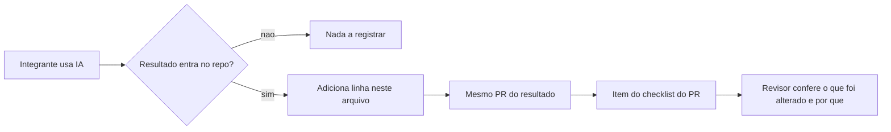

# Registro de IA

Uso de ferramentas de IA é autorizado em qualquer volume, com declaração obrigatória (caderno, seção 8). O que se avalia é a qualidade da crítica ao resultado, não o volume. Uso declarado nunca é penalizado; uso não declarado, havendo evidência, zera o critério C8.

## Como usar

- **Quando registrar:** sempre que um resultado de IA entra no repositório (código, documento, ADR, teste, dado tratado). Pergunta de dúvida que não vira artefato não precisa de linha.
- **Quem:** o autor do PR, na mesma branch e no mesmo PR do resultado. O [template de PR](../.github/pull_request_template.md) cobra esse item.
- **O que escrever:** o que foi pedido (resumo do prompt), o que voltou e, principalmente, o que a equipe alterou e por quê. "Usado sem alteração" é aceitável, desde que diga como foi verificado.
- **Erro identificado:** todo erro de IA encontrado durante o semestre vira candidato na lista de candidatos abaixo; antes de 30/11 a equipe escolhe um para a seção de encerramento.
- **Rastro no commit (opcional):** rodapé `Assisted-by: <ferramenta>` no commit, para cruzar com este registro.

## Registro

| Data | Integrante | Ferramenta | O que foi solicitado | O que retornou | O que a equipe alterou e por quê |
|---|---|---|---|---|---|
| 2026-10-11 | `<nome>` | Cursor (agente) | Dividir a empresa em cerca de 4 squads a partir do caderno | Proposta de 4 squads em 3 frentes e rascunho do [ADR-000](adr/000-divisao-e-frentes.md) | `<a preencher: o que a assembleia manteve ou mudou>` |
| 2026-10-14 | Gustavo Vieira | Cursor (agente) | Comparar stacks e fechar o ADR-004 com versões pinadas | Comparação Python/FastAPI versus Node/Fastify, recomendando FastAPI; versões consultadas no npm e em nodejs.org | A equipe escolheu Node/Fastify (contrário à recomendação) pela continuidade com o projeto anterior em JavaScript; o agente propôs Node 22 no plano, corrigido para 24.22.0 porque a 24 é a LTS ativa na data |
| 2026-10-14 | `<nome>` | Cursor (agente) | Adaptar a documentação do projeto anterior (Horta) às etapas A1.0 a A1.6 para o Fila Virtual | README, docs de processo e métricas, stakeholders, backlog, SRS, casos de uso, RFC, ADRs 001 a 004, plano de SCM, templates do GitHub e estratégia de testes | `<a preencher: valores revisados, eixos confirmados com o veterinário, etc.>` |
| 2026-10-20 | Gustavo Vieira | Cursor (agente) | Montar o kanban de tarefas por squad, de S3 até a entrega final, no GitHub | 72 issues com critério de aceitação e referências a RF, UC e ADR; labels por squad e MoSCoW; 8 milestones (um por marco); GitHub Project com campos Status, Squad e Prioridade | `<a preencher: tarefas removidas, movidas de marco ou reatribuídas na revisão do board pela empresa>` |
| 2026-10-20 | Gustavo Vieira | Cursor (agente) | Aplicar a proteção da `main` descrita no plano de SCM (issue #5), criar `.gitignore` e `CODEOWNERS` | Proteção aplicada via API, `.gitignore`, `CODEOWNERS` para contratos e modelo de dados, evidência no plano de SCM | O agente apontou que `CODEOWNERS` em repositório de usuário exige só um dos donos, não "arquiteto e outra frente"; o texto da seção 1.2 foi ajustado para dizer o que o GitHub garante e o que fica como regra de processo. O agente pôs só o Bruno como dono de fora do Domínio, a partir do ADR-000 desatualizado; o gerente trocou por donos por caminho com Jenifer Gomes (Canais) e Philipe Gonçalves (Borda) |
| 2026-11-15 | Gustavo Vieira | Cursor (agente) | Organizar notas desordenadas da entrevista na clínica e atualizar RF/ADR | `docs/campo/entrevista-2026-10.md`, `decisoes-da-clinica.md`, RF-01/02/03 e contexto do ADR-003 | A equipe revisa se "urgência" clínica precisa de estado próprio além de emergência (RF-05); salas de isolamento e faixas F2 ficam para as janelas |
| 2026-11-16 | Philipe Gonçalves | Cursor (agente) | Conferir se a issue #23 fecha com a entrevista já em `main` (commit `928a6c9`, PR #75), sem reescrever o levantamento | Confirmação dos dois critérios: eixos espécie e risco/comportamento mais FIFO de pequenos, com fonte em `docs/campo/entrevista-2026-10.md` e `decisoes-da-clinica.md`; RF-02 e RF-03 já apontam essa entrevista | Nada do texto de campo foi reescrito. Salas de isolamento, dois reativos ou cio ao mesmo tempo e "urgência" como estado ficam para as janelas. O aceite do ADR-003 continua na issue #24 |
| 2026-11-16 | Philipe Gonçalves | Cursor (agente) | Aceitar o ADR-003 (issue #24): status aceito, exemplo de sala ocupada e resumo na RFC-001 | Status aceito em 2026-11-16; exemplo concreto alinhado ao UC-02 E1; RFC seção 6 atualizada de Proposto para Aceito | Mantida a premissa de sala única (RF-04) enquanto as janelas não confirmam o número; o alocador em código continua na issue #28 |
| 2026-11-16 | Philipe Gonçalves | Cursor (agente) | Schemas Zod da issue #25 em `packages/contratos` (ingresso, posição, emergência, encerramento, 422 e 403), commit sem PR | Pacote `@fila-virtual/contratos`, testes Vitest e paths anotados na RFC-001 seção 5.2 | Porte ficou texto livre porque a entrevista não fechou a escala; a #25 não foi fechada — falta revisão do Squad 3 no PR |

## Erro da ferramenta identificado pela equipe

Seção obrigatória de encerramento: um erro cometido pela ferramenta neste projeto, como foi detectado e qual correção foi aplicada.

- **Erro:** `<a preencher>`
- **Como foi detectado:** `<a preencher>`
- **Correção aplicada:** `<a preencher>`

### Candidatos

> Candidato já observado: a primeira versão do ADR-002 descrevia a estimativa por "simulação simples", o que contradiz o critério de aceitação de RF-06 (resultado conferível à mão contra planilha). Foi corrigido para reamostragem com semente fixa. A equipe deve confirmar se este é o caso a relatar ou substituí-lo por outro encontrado na revisão.
