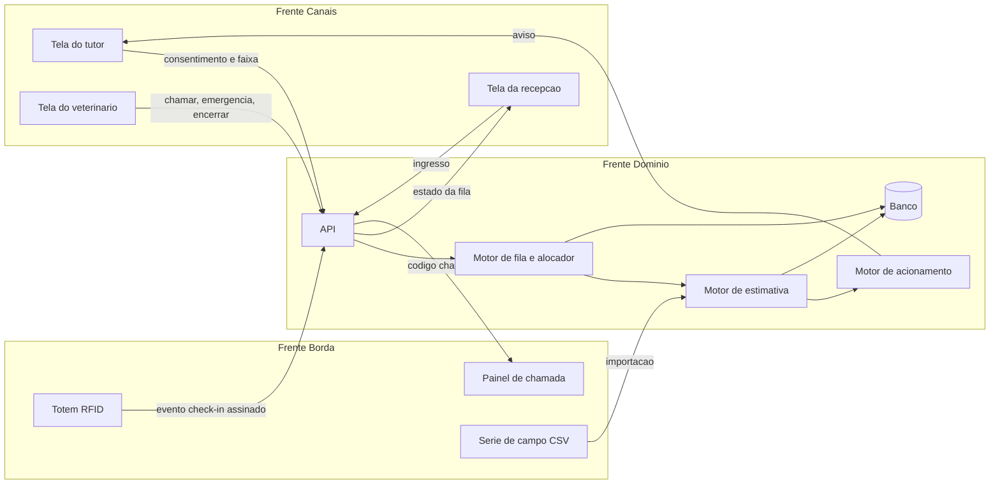

# RFC-001: Arquitetura do MVP do Fila Virtual

## Cabeçalho

| Campo | Valor |
|---|---|
| Status | Em revisão |
| Versão | 0.1 |
| Autores | `<arquiteto>`, `<representantes das frentes Domínio, Canais e Borda>` |
| Data | 2026-10-14 |
| Marco | S4 (26/10) — Marco crítico de arquitetura |
| Substitui | — |

---

## 1. Contexto e Motivação

Em clínicas veterinárias com demanda concentrada, o tutor espera na recepção com o animal no colo ou na caixa de transporte, ao lado de outras espécies e de animais reativos, sem saber quanto falta. O Fila Virtual permite que a espera aconteça fora da recepção: a clínica registra a chegada, o sistema separa os casos que não podem dividir o ambiente, informa ao tutor uma faixa honesta de tempo restante e o chama na hora certa, considerando a distância dele.

Usuários: recepção, médico-veterinário e tutor (pelo próprio celular, sem instalar app). O sistema não decide nada clínico, trata localização com o mínimo exigido pela LGPD e precisa continuar funcionando quando a internet do tutor, a permissão de localização ou o hardware da recepção falham.

---

## 2. Escopo deste Marco

**Dentro do escopo:**

- Ingresso, filas segregadas e alocação de recursos (F3)
- Estimativa p50–p90 por tipo, previsto versus realizado e erro médio (F1)
- Acionamento por distância com degradação para tempo fixo (F2)
- Telas web da recepção, do veterinário e do tutor
- Importação da série de campo
- Esquema de hardware e contrato Borda para Domínio

**Fora do escopo (próximas RFCs):**

- Implementação física de totem e painel (v2)
- Segundo canal de aviso definitivo (RF-16 é Should)
- Painel de indicadores avançado (RF-17)
- Aplicativo nativo, agendamento online, integração com prontuário

---

## 3. Requisitos Atendidos

- SRS (A1.2): [`docs/requirements/srs.md`](../requirements/srs.md)
- Casos de Uso (A1.3): [`docs/requirements/casos-de-uso.md`](../requirements/casos-de-uso.md)

**UCs críticos suportados por esta RFC:**

- **UC-01** — Registrar chegada e informar estimativa com faixa
- **UC-02** — Inserir caso que exige segregação
- **UC-03** — Classificar emergência
- **UC-04** — Acionar tutor por distância
- **UC-05** — Encerrar atendimento e comparar previsto com realizado
- **UC-06** — Check-in pelo totem e chamada no painel (contrato apenas)

---

## 4. Stack Tecnológica

Decidida no [ADR-004](../adr/004-escolha-da-stack.md). Monorepo com npm workspaces: `apps/api`, `apps/web`, `packages/contratos`.

| Camada | Tecnologia | Versão | Por quê (1 frase) |
|---|---|---|---|
| Runtime | Node.js LTS | 24.22.0 | LTS ativa; uma linguagem para API e telas, como no projeto anterior da equipe |
| Linguagem | TypeScript | 7.0.2 | Tipos do contrato compartilhados entre as frentes Domínio e Canais |
| API / Domínio | Fastify | 5.12.7 | Leve, com validação por schema em cada rota |
| Contrato | Zod + fastify-type-provider-zod | 4.6.7 / 7.0.0 | O mesmo schema valida a API, tipa as telas e gera o OpenAPI |
| OpenAPI | @fastify/swagger + @fastify/swagger-ui | 9.9.2 / 6.1.2 | Contrato publicado em `/docs` e versionado para o congelamento de 26/10 |
| Acesso ao banco | drizzle-orm + drizzle-kit | 0.45.4 / 0.31.11 | Consultas tipadas e migrações versionadas em SQL legível |
| Banco relacional | PostgreSQL (Neon) | 17 | Relacional para filas, recursos e estimativas; mesmo SGBD da disciplina de banco de dados |
| Telas web | React + Vite | 19.3.1 / 8.3.4 | Telas leves para caber no RNF-05 (≤ 500 KB) |
| Tempo real | Server-Sent Events | — | Só servidor para cliente, que é o que as telas precisam (RNF-02); sem biblioteca extra |
| Testes | Vitest + @playwright/test | 5.0.4 / 1.64.1 | Unit, integration e contract no Vitest; roteiro de demonstração no Playwright |
| Borda (esquema) | ESP32 via HTTP | — | Confirmado no ADR de hardware do Squad 4 |
| Hospedagem | Vercel (telas), Render (API), Neon (banco) | — | Planos gratuitos (restrição C-01) |

---

## 5. Arquitetura do Sistema

### 5.1 Diagrama de Componentes

O diagrama acima é a fonte. Uma versão em imagem, se gerada, fica em [`assets/`](assets/).

### 5.2 Fluxo de Dados (Cenários)

#### Cenário 1: ingresso com estimativa (atende UC-01 e UC-02)

1. A recepção envia `POST /atendimentos` com espécie, porte, tipo e marcadores.
2. A API valida (422 em erro) e o motor de fila posiciona o caso na fila do eixo espécie/risco.
3. O motor de estimativa calcula p50/p90 com a série do tipo (ou agregada, se < 8 amostras).
4. A API grava atendimento e estimativa inicial (base do previsto versus realizado).
5. A API devolve o link do tutor com token e publica o novo estado da fila para as telas abertas.

#### Cenário 2: acionamento por distância (atende UC-04)

1. A tela do tutor obtém a posição uma vez e envia `POST /atendimentos/{id}/localizacao`.
2. A API converte em faixa e tempo de deslocamento, descarta a coordenada e grava faixa e consentimento.
3. A cada mudança da fila, o motor de acionamento compara p50 restante com deslocamento + margem (ou tempo fixo, se sem faixa).
4. Ao atingir o limiar, envia o aviso e registra `acionamento` com o critério usado.
5. Sem confirmação em 3 min, reenvia e alerta a recepção.

#### Cenário 3: encerramento e calibração (atende UC-05)

1. O veterinário envia `POST /atendimentos/{id}/encerrar`.
2. A API grava o fim, calcula o erro do atendimento e o motor de estimativa incorpora a duração (exceto se `suspeita`).
3. As estimativas da fila são recalculadas e publicadas.

### 5.3 Fronteiras e Responsabilidades

| Componente | Squad | Responsável por | NÃO faz |
|---|---|---|---|
| Motor de fila e alocador | 1 — Fila | Filas por eixo, desempate, recursos, emergência | Não calcula tempo; não classifica gravidade |
| Motor de estimativa | 2 — Estimativa | p50/p90 por tipo, erro médio, importação da série | Não reordena a fila |
| Motor de acionamento | 3 — Tutor | Decide quando avisar e por qual critério | Não guarda coordenadas |
| Telas web | 3 — Tutor | Interação de recepção, veterinário e tutor | Não contém regra de fila ou estimativa |
| Totem e painel | 4 — Campo e hardware | Eventos físicos de check-in e exibição da chamada | Não criam ingresso sem confirmação da recepção |
| Banco | Arquiteto | Atendimentos, filas, recursos, estimativas, faixas, consentimentos | Não armazena nome de tutor nem coordenada |

Contratos congelados em 26/10: Domínio para Canais, Canais para Domínio e Borda para Domínio ([ADR-000](../adr/000-divisao-e-frentes.md)).

---

## 6. Decisões de Arquitetura (ADRs)

Cada ADR é registrado em arquivo próprio em [`docs/adr/`](../adr/), commitado na data da decisão (regra do caderno). Esta seção resume as decisões que moldam a arquitetura.

### ADR-001: Posição do tutor em momentos-chave

**Status:** Proposto — **Data:** 2026-10-20 — [arquivo](../adr/001-posicao-do-tutor.md)

**Contexto.** A F2 usa a distância para decidir o acionamento, não para rastrear; o tutor usa navegador e pode recusar a permissão.

**Opções consideradas:** rastreamento contínuo; posição em até 3 momentos-chave; sem geolocalização.

**Decisão.** Posição em momentos-chave, convertida em faixa e descartada; retenção de 24 h; degradação para tempo fixo.

**Consequências.** Menos precisão para quem não reabre o link; em troca, nenhum dado de posição precisa no banco e o sistema funciona sem permissão.

### ADR-002: Faixa p50–p90 por percentis empíricos

**Status:** Proposto — **Data:** 2026-10-20 — [arquivo](../adr/002-faixa-da-estimativa.md)

**Contexto.** Durações assimétricas e série pequena (dezenas de amostras por tipo).

**Opções consideradas:** média ± desvio; percentis empíricos; modelo de filas.

**Decisão.** Percentis empíricos por tipo, com fallback agregado abaixo de 8 amostras.

**Consequências.** Faixa larga no início; em troca, faixa nunca negativa e verificável à mão.

### ADR-003: Filas segregadas com alocador de recursos

**Status:** Proposto — **Data:** 2026-10-20 — [arquivo](../adr/003-alocacao-de-recurso-compartilhado.md)

**Contexto.** Veterinário compartilhado entre espécies e sala de isolamento única.

**Opções consideradas:** N filas independentes; fila única ponderada; filas segregadas + alocador.

**Decisão.** Espera segregada; a chamada escolhe entre cabeças de fila com recurso livre.

**Consequências.** Modelo de recursos no contrato e no banco; em troca, regra testável e passo 2 do roteiro verificável.

### ADR-004: Escolha da stack

**Status:** Aceito — **Data:** 2026-10-20 — [arquivo](../adr/004-escolha-da-stack.md)

**Contexto.** Contratos entre três frentes congelam em 26/10 (risco R3); custo zero; equipe com experiência prévia em JavaScript.

**Opções consideradas:** Python + FastAPI + React; Node + Fastify + Zod + React; backend-as-a-service.

**Decisão.** Node + Fastify + Zod em monorepo, com os schemas do contrato num pacote compartilhado entre API e telas; versões na seção 4.

**Consequências.** Percentis implementados no projeto e OpenAPI dependente de plugin; em troca, uma linguagem só e o contrato escrito uma vez para as duas frentes.

---

## 7. Telas (Wireframes)

Imagens dos wireframes vão para [`assets/wireframes/`](assets/). Até lá, cada tela é descrita pelo conteúdo.

### 7.1 Tela 1 — Recepção (atende UC-01, UC-02)

- **Informações exibidas:** filas lado a lado (cães, gatos, silvestres, isolamento), posição, tipo, estimativa, estado da sala de isolamento, alertas de aviso não confirmado.
- **Ações disponíveis:** novo ingresso, editar marcadores, marcar "sem link", mostrar QR code.
- **Navegação:** histórico do dia.

### 7.2 Tela 2 — Veterinário (atende UC-03, UC-05)

- **Informações exibidas:** próximo elegível por recurso, atendimento em curso com duração.
- **Ações disponíveis:** chamar próximo, classificar emergência, alterar tipo, encerrar.
- **Navegação:** histórico do dia.

### 7.3 Tela 3 — Tutor (atende UC-01, UC-04)

- **Informações exibidas:** posição, faixa "entre X e Y minutos", critério de aviso (distância ou tempo fixo), aviso de aumento por emergência.
- **Ações disponíveis:** conceder ou recusar localização, "Estou a caminho".
- **Navegação:** tela única, acessada pelo link com token.

### 7.4 Tela 4 — Histórico do dia (atende UC-05)

- **Informações exibidas:** atendimentos encerrados com tipo, previsto, realizado e erro; erro médio por tipo.
- **Ações disponíveis:** filtrar por tipo e período.
- **Navegação:** a partir das telas da recepção e do veterinário.

---

## 8. Riscos e Mitigações

| Risco | Probabilidade | Impacto | Mitigação |
|---|---|---|---|
| R1 — Tutor não recebe o aviso | Média | Alto | Dois canais + confirmação de leitura; alerta à recepção após 3 min (UC-04, E3) |
| R2 — Clínica cancela a autorização | Baixa | Alto | Segunda clínica identificada como reserva; série retrospectiva declarada como tal |
| R3 — As três frentes não integram a tempo | Alta | Alto | Contratos OpenAPI congelados em 26/10; contract tests entre frentes ([estratégia de testes](../test-strategy.md)) |
| R4 — Série com poucas amostras por tipo | Média | Médio | Fallback agregado e marcação de estimativa degradada (ADR-002) |
| R5 — Hibernação da hospedagem gratuita na bancada cruzada | Média | Médio | Monitor externo a cada 5 min no período (RNF-10); retorno ≤ 60 s documentado no manual |

---

## 9. Fora do Escopo / Próximos Passos

- ADR de hardware: escolha entre totem e painel, protocolo HTTP ou MQTT, alimentação calculada (Squad 4, até 26/10)
- Modelo de dados e contratos OpenAPI das três fronteiras (até 26/10)
- Wireframes em imagem para as 4 telas
- Implementação física do totem ou painel (v2)

---

## Referências

- [Caderno do aluno — Fila Virtual](../../Projeto_Integrador_Fila_Virtual_Caderno_do_Aluno_1.pdf)
- [ADR-000 — Divisão em frentes e squads](../adr/000-divisao-e-frentes.md)
- [SRS](../requirements/srs.md) e [Casos de Uso](../requirements/casos-de-uso.md)
